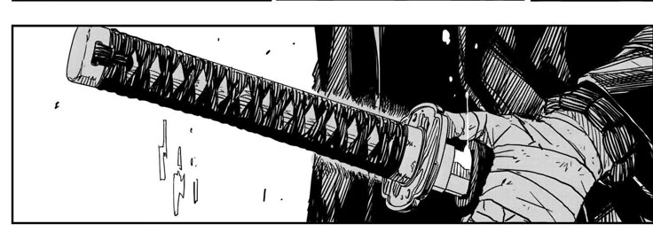

## FRPortfolio - Digital Web Portfolio

## Hi, I'm Fatur 👋

<picture>
  <source media="(prefers-color-scheme: dark)" srcset="https://readme-typing-svg.demolab.com?font=Fira+Code&weight=600&size=20&pause=1000&color=FFFFFF&center=true&vCenter=true&width=600&lines=Software+Engineering+Student;UI%2FUX+Designer;Android+Modder+%26+Developer">
  <source media="(prefers-color-scheme: light)" srcset="https://readme-typing-svg.demolab.com?font=Fira+Code&weight=600&size=20&pause=1000&color=0D1117&center=true&vCenter=true&width=600&lines=Software+Engineering+Student;UI%2FUX+Designer;Android+Modder+%26+Developer">
  
</picture>

  <em>Designing interfaces, exploring systems, and building ideas through code.</em>

  
  

---

## 📖 About Me

I'm a Software Engineering (RPL) student based in Indonesia, passionate about crafting intuitive UI/UX designs, mobile system modding, and full-stack software development.

- 🎨 **Design Philosophy:** Clean, functional, and user-centric visual aesthetics.
- 📱 **Android Modding:** Custom ROM porting, Magisk module development, and system tweaks.
- ✍️ **Content & Creation:** Technical writing, visual UI design, and tech content creation.
- 💻 **Engineering:** Constantly experimenting with new frameworks, tools, and system architectures.
- 🚀 **Current Focus:** Deepening core software architecture and mobile system optimization.

 

**🌐 Languages:**  
🇮🇩 Indonesian (Native) • 🇮🇩 Sundanese (Conversational) • 🇺🇸 English (Learning) • 🇯🇵 Japanese (Beginner)

## 💻 My Tech Stack

  
  
  
  
   
  
  
  
  
  
  
  
  
   
  
  
  
  
  

## 📚 Currently Learning

  <code>Development Workflow with VSCode</code> <code>Android Modding</code> <code>UI/UX Designer</code> <code>Website Development</code> <code>MiniGame Development</code> <code>Roblox Studio</code>

## 📊 GitHub Statistics

  

  

  

## 🔗 Connect With Me

  
  
  
  

<!-- PACMAN -->
<picture>
  <source media="(prefers-color-scheme: dark)" srcset="https://raw.githubusercontent.com/rh-fatur/rh-fatur/output/pacman-contribution-graph-dark.svg">
  <source media="(prefers-color-scheme: light)" srcset="https://raw.githubusercontent.com/rh-fatur/rh-fatur/output/pacman-contribution-graph.svg">
  
</picture>

<i>"Creating, experimenting, and improving — one line at a time."</i>

**Thanks for visiting my profile!**

